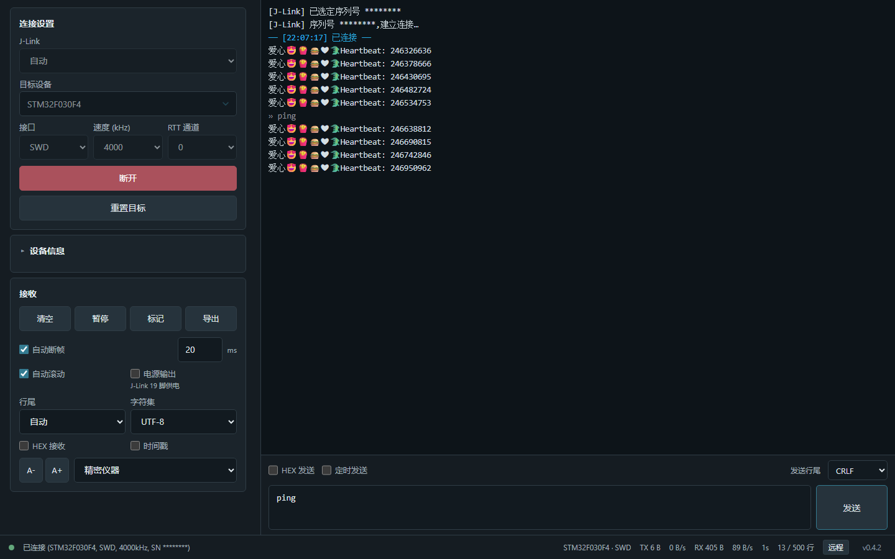

# Mini RTT Viewer

轻量级 SEGGER RTT 日志查看器 —— 为 **UTF-8 / emoji** 而生。

[](https://github.com/MisakaMikoto128/mini-rtt-viewer/actions/workflows/ci.yml)
[](https://github.com/MisakaMikoto128/mini-rtt-viewer/releases/latest)
[](LICENSE)


项目主页:<https://misakamikoto128.github.io/mini-rtt-viewer/>



## 为什么做这个

官方 J-Link RTT Viewer 对 UTF-8 的支持是坏的:中文乱码、emoji 直接丢失。这个项目用 Rust 重写了核心的"连接 + 看日志 + 发数据"体验(数据层纯 Rust,界面为内嵌 Web 管理台):

- **单文件 exe,UPX 后约 0.85 MB**,无需安装,拷给同事就能用
- **启动不到 1 秒**,没有 Python 运行时(WebView2 用 Windows 自带)
- **UTF-8 完整支持**,中文 / emoji 原样显示,跨读取块的多字节序列自动拼接
- **实时流畅**:10ms 界面刷新粒度,均匀发送的消息逐条均匀上屏;日志行数上限 500 行(超出丢最旧),长时间流式输出不卡 UI
- 无换行符的裸流(如裸 printf 数值)可开启**自动断帧**:相邻数据到达间隔超过设定值(1~200ms)自动换行。等待跟着判定点走,判定精确落在设定值上——设 1ms 就是 1ms,不会被轮询间隔量化上取整
- **自动滚动不拉扯**:滚离底部即暂停自动跟随,滚回贴底自动恢复;双击启动即桌面窗口,也可经托盘/浏览器访问同一管理台

## 功能

- 连接设置:目标芯片型号(设备库自动补全)/ SWD / JTAG / 速率 (100–12000 kHz) / RTT 通道 0–15 / 多台 J-Link 列表
- 接收:ANSI 转义序列着色、暂停接收、自动断帧 + 超时可调、接收行尾可选(自动 / CRLF / LF / CR / 无)、HEX 接收、字符集 5 种(连接中切换动态生效)
- 发送:向所选下行通道发送数据,Enter 快捷发送,成功后保留原文便于修改和连续重发,行尾可选(CRLF / LF / CR / 无),HEX 发送、定时发送、发送历史 ↑↓
- 日志:七套内置主题(深色/浅色/OLED 纯黑/护眼暖色/精密仪器/终端专注/实验室浅色)+ 自定义主题(themes/*.css 拖入即用),主题选择本机保存并在刷新后恢复;VS Code 式正则搜索(Ctrl+F)、拖选/右键复制、导出 .log、长行自动换行
- 会话:连接/断开自动标记、手动标记、TX/RX 字节与速率、会话时长、日志时间戳开关
- 双形态:桌面壳(窗口 + 托盘)与纯服务(`--no-window`)共用同一管理台;单实例互斥(端口)

## 使用前提

- Windows 10/11 x64
- 已安装 [SEGGER J-Link 软件包](https://www.segger.com/downloads/jlink/)(程序运行时加载 `JLink_x64.dll`)
- J-Link 调试器 + 目标板固件已初始化 SEGGER RTT(`SEGGER_RTT` 组件)

芯片型号需填写 J-Link 支持的完整型号名(如 `STM32F030C8`、`STM32H750VB`),与官方 RTT Viewer 中的写法一致。

## 命令行

```text
mini-rtt-viewer [--backend jlink] [--listen 127.0.0.1] [--port 8686]
                [--no-window] [--no-tray]
```

默认监听 `127.0.0.1:8686`，桌面窗口与浏览器共用管理台。`--no-window` 仅启动服务；
`--listen 0.0.0.0` 会开放无鉴权控制面，仅在可信网络中使用。完整说明运行
`mini-rtt-viewer --help`。

## 构建

```bat
cargo build --release
cargo test --locked
build_release.bat   :: 构建 + 可选 UPX 压缩 + 输出到 dist\
```

Rust 1.75+。`tools/` 目录放入 UPX(可选)后脚本会自动压缩，不存在时跳过压缩。
提交前运行完整门禁：

```bash
cargo fmt --check
cargo clippy --all-targets --locked -- -D warnings
cargo test --locked
python -m pytest tests/web -q
```

Web 测试需要正式程序与独立 QA 示例两个可执行文件，先运行
`cargo build --release --locked --bins --examples`。默认使用
`target/release/mini-rtt-viewer.exe` 和 `target/release/examples/qa_server.exe`；
也可分别通过 `RTT_TEST_EXE`、`RTT_QA_EXE` 指定当前构建。QA 后端只用于无硬件测试，
不会出现在正式程序中。测试会使用临时偏好文件和临时 APPDATA，不读写真实用户配置。

## 发布

推送 tag 自动构建并发布到 GitHub Releases(Windows x64):

```bash
git tag v0.1.0
git push origin v0.1.0
```

CI 配置见 [.github/workflows/release.yml](.github/workflows/release.yml)。

## 技术栈

| 组件 | 选择 | 理由 |
|---|---|---|
| UI | 内嵌 Web 管理台(原生 HTML/CSS/ES modules,编译期内嵌)+ tao/wry 桌面壳 | 无前端构建步骤;CSS 布局成熟、DevTools 可调试;WebView2 随 Windows 10/11 自带;`--no-window` 纯服务共用同一界面 |
| J-Link 访问 | FFI 直调 `JLink_x64.dll` | 与官方工具/驱动共存,不抢 USB(纯 USB 协议实现需要 Zadig 换驱动,会破坏 SEGGER 工具链) |
| 并发模型 | std::thread + mpsc + 10ms 消息泵 | worker 读线程不碰 UI,泵做断行与事件广播;停止/退出经原子标志轮询,阻塞等待均有界 |

连接时序沿用了经过验证的 J-Link DLL 状态机要求(RTT START 在 connect 之前建立)。

## 代码结构

| 文件 | 职责 |
|---|---|
| `src/lib.rs` | 模块树唯一入口,bin/examples 一律 `use` 本 crate |
| `src/main.rs` | CLI 入口(`--backend` / `--listen` / `--port` / `--no-window` / `--no-tray`):分派桌面壳 / 纯服务两种形态 |
| `src/gui.rs` | 桌面壳:tao 事件循环 + wry WebView(内嵌管理台)+ 托盘图标与退出序列 |
| `src/backend.rs` | `RttBackend` 后端抽象、会话协议与注册表；正式程序注册 J-Link |
| `src/backend_jlink.rs` | J-Link 后端：worker 生命周期、探针枚举桥接与复位重连 |
| `src/web.rs` | Web facade：服务装配、固定路由与后端解析，API 契约见模块头注释 |
| `src/web/` | 按职责拆分的共享状态、HTTP API、数据泵、WebSocket 与主题扫描 |
| `src/config.rs` | 业务偏好唯一持久化真源(`%APPDATA%/MiniRttViewer/prefs.json`,serde 容错 + 原子写) |
| `src/log_model.rs` | 日志泵纯逻辑(断行/缓冲/ANSI 带色行/行数上限),有单元测试 |
| `src/ansi.rs` | ANSI 转义 → 带色文本段(vte 状态机,颜色状态跨行跨块保持),有单元测试 |
| `src/rtt.rs` | worker 线程:`connect_target` 连接序列 + `rtt_read_loop` 读循环(断帧判定/命令消化/字符集增量解码) |
| `src/jlink_dll.rs` | JLink_x64.dll 最小 FFI 绑定(连接/RTT/设备信息/调试器与设备库枚举选定) |
| `src/device_db.rs` | 设备库后台枚举 + 磁盘缓存 + 多台调试器列表 |
| `ui/web/index.html` | 管理台语义结构；连接/设备/接收侧栏、日志、发送区与状态栏 |
| `ui/web/styles.css` | 七主题令牌、原左右布局、3px 滚动条与键盘焦点样式 |
| `ui/web/*.js` | 原生 ES modules：全局协调、API、日志视图、搜索、显示设置与弹窗 |
| `examples/qa_server.rs` | 仅供 Web 黑盒测试的独立 QA 数据流，不参与正式后端注册 |
| `examples/emu_check.rs` | 无界面验证:枚举调试器 + 选定/实际打开一致性 |
| `examples/rtt_check.rs` | 无界面 RTT 直读(连接序列排障用) |
| `AGENTS.md` | 实际踩坑经验笔记(改代码前先读) |

## License

[MIT](LICENSE)
